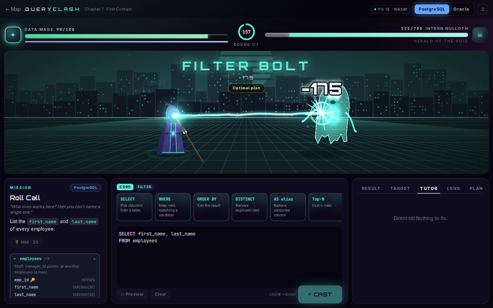
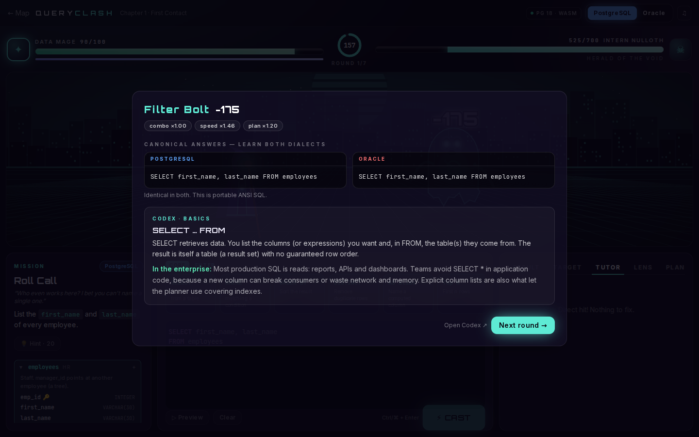
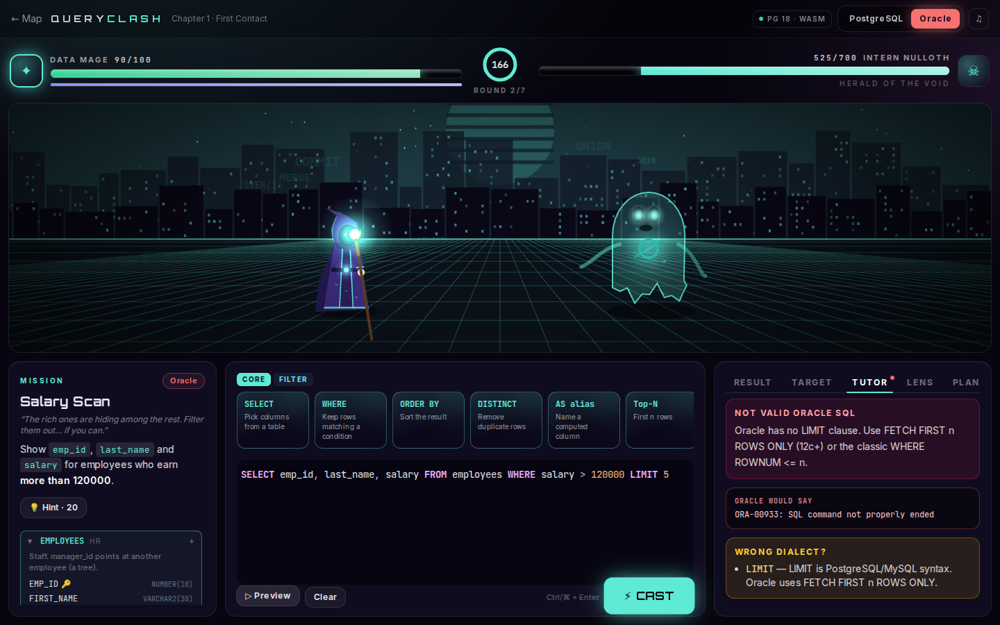
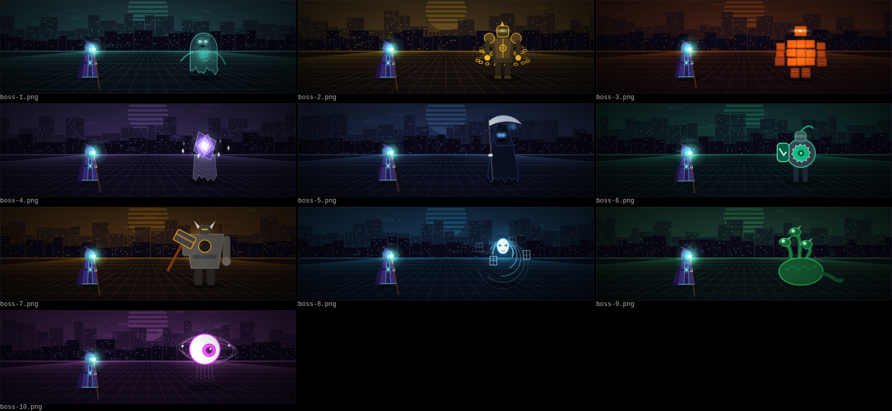

# Query Clash

A 1v1 action battle game that teaches SQL, from `SELECT` to recursive CTEs, in both **PostgreSQL** and **Oracle**. Your queries are your spells: write one that returns the right result and your Data Mage attacks; get it wrong and the boss hits back.

Queries run on **real PostgreSQL 18** compiled to WebAssembly ([PGlite](https://pglite.dev)), inside your browser. There's no server and no install, and it works offline once loaded.

**Stack:** Next.js 16 (App Router) · React 19 · TypeScript · Tailwind CSS 4 · PixiJS 8 (WebGL) · Motion · CodeMirror 6 · PGlite (Postgres 18 → WASM) · Web Audio · Vitest



---

## What you get

| | |
|---|---|
| **Campaign** | 10 bosses, 61 missions, basics to advanced. Each boss owns a chapter of the curriculum. Earn up to 3 stars per chapter. |
| **Endless Arena** | Waves of bosses with random missions from every chapter you've unlocked. You heal between waves. |
| **Versus (hot-seat)** | Two players, one keyboard, each in their own dialect. A correct query hits your rival; a wrong one passes the turn. |
| **Sandbox** | A free SQL playground on the same database, with examples and a live Oracle→PostgreSQL translation. |
| **Codex** | 61 reference entries. Each has a definition, syntax in both dialects, an *In the enterprise* note, pitfalls, Oracle-vs-Postgres differences and a quiz. Entries unlock as you win missions (or turn on study mode). |
| **Bestiary** | Meet every boss and preview all 14 spell animations. |

### How a battle works

1. Each round gives you a **mission**, for example *"List employees who earn more than their own department's average."*
2. Build the query **with the mouse or the keyboard**. Click or drag **spell cards** (clause templates with tab-through fields) and **schema names** into the editor, which has schema-aware autocomplete.
3. **Cast** it (Ctrl/⌘ + Enter). The game runs your SQL on a fresh copy of the database and compares the result with the reference answer. Row order only matters when the mission asks for `ORDER BY`, and column names don't matter.
4. **Hit:** the SQL concepts you used decide the spell. A JOIN throws chains, window functions slash, recursive CTEs summon minions, MERGE calls a storm, and so on. Damage scales with:
   - **combo:** how many distinct advanced concepts the query uses,
   - **speed:** time left on the clock,
   - **plan:** the planner cost from `EXPLAIN`, compared with the reference answer. A cheaper plan hits harder, so performance is part of the game.
   - **crit:** a first-try, hint-free, fast answer.
5. **Miss:** the boss counter-attacks, and the **Tutor** tab explains the error in plain English. In Oracle mode it also shows the ORA- error Oracle would raise.
6. After every hit, the **debrief** shows the canonical answer in *both* dialects and the Codex entry for the concept.

Spend focus on **hints** or to **scout** the target result set. **Defense** missions start with the boss corrupting data inside an open transaction, and you have to `ROLLBACK` (or roll back to a savepoint) to save it.



## Oracle support

Oracle can't run in a browser, so Oracle mode is an **emulator**, and the UI says so. It works in three stages:

1. **Lint:** PostgreSQL-only syntax is rejected with the error Oracle itself would raise. `LIMIT` gives `ORA-00933`, `::` gives `ORA-00911`, `ILIKE` gives `ORA-00920`, a table alias with `AS` gives `ORA-00933`, `WITH RECURSIVE` gives `ORA-00905`, and `BEGIN;` gives `PLS-00103`.
2. **Transpile** (`lib/dialect/oracle.ts`): the Oracle SQL is rewritten as equivalent PostgreSQL, one token at a time.
   - `DUAL`, `NVL`, `NVL2`, `DECODE`, `SYSDATE`, `ADD_MONTHS`, `MONTHS_BETWEEN`, `TRUNC(date, fmt)`, `INSTR`, `LISTAGG … WITHIN GROUP`, `MINUS`, `seq.NEXTVAL`
   - `ROWNUM`, including Oracle's "assigned before ORDER BY" semantics
   - `(+)` outer joins, rewritten as `LEFT JOIN`
   - `CONNECT BY` / `START WITH` / `PRIOR` / `LEVEL` / `SYS_CONNECT_BY_PATH` / `CONNECT_BY_ROOT` / `CONNECT_BY_ISLEAF` / `ORDER SIBLINGS BY`, rewritten as a recursive CTE, including the `CONNECT BY LEVEL <= n` row generator
   - `PIVOT`, rewritten as conditional aggregation (column lists come from the database)
   - Oracle-style recursive `WITH` (no `RECURSIVE` keyword) and `MERGE … WHERE`
   - `VARCHAR2`/`NUMBER`/`CLOB` types, `ALTER TABLE … ADD (…)` / `MODIFY`, identity columns, materialized-view options, bitmap and global temporary table notes
   - **Implicit transactions:** Oracle has no `BEGIN`, and DDL auto-commits. Both are emulated.
3. **Explain:** the **Translation Lens** shows your Oracle SQL next to the PostgreSQL that actually runs, with a note for every rewrite. PostgreSQL errors are mapped to their ORA- equivalents (`42P01` → `ORA-00942`, `42803` → `ORA-00979`, `23505` → `ORA-00001`, and so on).

Features that only make sense inside Oracle, such as PL/SQL packages and `UNPIVOT`, get a clear explanation instead of a silent failure. In PostgreSQL mode, Oracle-isms (`NVL`, `ROWNUM`, `DUAL`, `CONNECT BY`, …) trigger a "wrong dialect?" hint.



## Curriculum

| # | Boss | Topics |
|---|---|---|
| 1 | Intern Nulloth | SELECT, WHERE, ORDER BY, DISTINCT, NULL logic, IN/BETWEEN/LIKE, expressions |
| 2 | The Joinmaster | INNER/LEFT/FULL joins, multi-table joins, self joins, anti-joins |
| 3 | Aggregon | Aggregates, GROUP BY, HAVING, CASE, aggregates and NULL |
| 4 | Sub-Zero Query | Scalar/IN/correlated subqueries, EXISTS, the NOT IN + NULL trap, inline views |
| 5 | The DML Reaper | INSERT, INSERT…SELECT, UPDATE, DELETE and foreign keys, MERGE / ON CONFLICT |
| 6 | The Transactor | Atomic transfers, ROLLBACK, SAVEPOINT, isolation levels, SELECT … FOR UPDATE |
| 7 | Schemaforge | CREATE TABLE, constraints, ALTER TABLE, identity columns, views, CTAS |
| 8 | The Windwraith | ROW_NUMBER/RANK/DENSE_RANK, running totals, LAG, top-N per group, ratios |
| 9 | The Recursion Hydra | CTEs, recursive CTEs, CONNECT BY, paths, subtree roll-ups, calendars |
| 10 | The Optimizer | Indexes, sargable predicates, EXPLAIN, JSON, PIVOT, materialized views, a final multi-CTE report |

The database is a small, realistic enterprise schema: **HR** (locations, departments, employees as a tree), **Retail** (customers, a category tree, products, orders, order lines), **Banking** (accounts, transactions) and **Logistics** (shipments with JSON details). The data comes from a fixed seed, so every player and the test suite see identical rows. It deliberately includes edge cases: NULL commissions, an employee without a department, a department without employees, customers who never ordered, and salary ties.



## Architecture

```
app/                    routes: title, campaign, battle/[chapter], arena, versus, sandbox, codex, bestiary
components/battle/      BattleScreen (round flow), SqlEditor (CodeMirror), SpellDeck, SchemaExplorer,
                        ResultPanel (Result · Target · Tutor · Lens · Plan), StageView (Pixi host)
content/                schema + deterministic seed, 10 chapters of missions, Codex, spell cards
game/engine/            pure battle reducer and damage model (no rendering code)
game/render/            PixiJS stage: tween engine, pooled particles, camera (shake, hit-stop,
                        zoom punch, flash), rigged characters, 10 bosses, 14 spells + boss attacks
game/audio/             Web Audio synth: SFX and a step-sequenced music loop (no audio files)
lib/db/                 engine (reset/run/evaluate/EXPLAIN), Web Worker host, client with watchdog,
                        error tutor (SQLSTATE → plain English + ORA- code)
lib/dialect/            Oracle transpiler, dialect linter, concept detector (SQL features → attack)
lib/sql/                tokenizer and query-scope analysis used by the above
tests/                  transpiler equivalence tests + mission integrity tests (Vitest + PGlite)
```

Design notes:

- **The database runs in a Web Worker,** so a slow query never drops an animation frame. If a query runs longer than 8 s (for example an accidental Cartesian product), the client terminates the worker and boots a fresh database.
- **PGlite is served unbundled** from `/pglite` (copied by `scripts/copy-pglite.mjs` on install, dev and build) and imported natively by the worker. Its Emscripten loader finds `pglite.wasm` and `pglite.data` through `import.meta.url`, and a bundler rewriting that breaks it.
- **Every cast is judged from a clean database.** Scripts that change state mark the database dirty, and the engine rebuilds it from the seed before the next evaluation.
- **All mission answers are verified in CI.** `tests/missions.test.ts` runs every mission's Oracle answer (through the transpiler) and PostgreSQL answer on PGlite and checks they return the same, non-empty result.
- **All art is code.** Characters are vector rigs with pivots (arms, staff, heads, necks) animated by a small promise-based tween engine. Nothing is loaded from image files.
- **Progress lives in localStorage.** It's per browser. Settings include volume, music, reduced motion (less shake, fewer particles) and a Zen mode with no timer.

## Run it

```bash
cd sql-battle
npm install        # also copies PGlite's runtime into public/pglite
npm run dev        # http://localhost:3000
```

```bash
npm test           # transpiler + all 61 missions in both dialects (real PGlite)
npm run lint
npm run typecheck
npm run build && npm start
```

Requires Node 22+. Every route is pre-rendered and there's no backend, so it deploys to any Next.js host (e.g. Vercel) or runs with `npm start`.

## Honest limits

- Oracle is **emulated**. The emulator targets Oracle 19c semantics with notes for 21c and 23ai features, and covers the SQL the game teaches. It doesn't implement PL/SQL, Oracle's empty-string-is-NULL rule, or `'a' || NULL = 'a'` concatenation; the Codex explains all three.
- Plan-cost damage uses the PostgreSQL planner in both modes.
- The animations are GPU-accelerated WebGL. On machines without GPU acceleration (software rendering), they run at a reduced frame rate.
